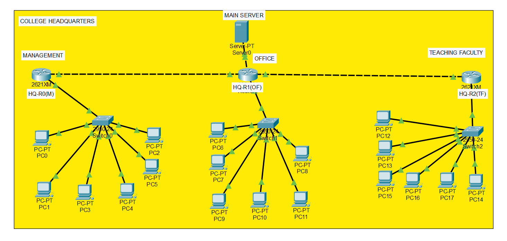

# 🏫 College Campus LAN Network

<p align="center">
  
</p>

<p align="center">
  <strong>Enterprise Multi-Department Campus Network Simulation</strong><br />
  <em>Automated Dynamic Addressing (DHCP Relay) • Resilient Mesh Backbone Routing (OSPF Area 0) • Subnet Isolation</em>
</p>

<p align="center">
  <a href="#"></a>
  <a href="#"></a>
  <a href="#"></a>
  <a href="#"></a>
  <a href="#"></a>
</p>

---

## 📌 Executive Summary

The **College Campus LAN Network** is an enterprise-grade network simulation engineered in **Cisco Packet Tracer**. It models an educational institution's core digital infrastructure divided into three autonomous departmental zones: **Management**, **Office & Accounts**, and **Teaching Faculty**, backed by a centralized **Server Farm**.

The infrastructure eliminates manual host configuration through **DHCP Relay Agents (`ip helper-address`)**, achieves full mesh backbone reachability through **OSPF Area 0** using Dijkstra's Shortest Path First (SPF) algorithm, and guarantees **100% autonomous fault recovery** during simulated core link severance.

---

## 🏛️ Network Architecture & Department Zones

```
                     ┌──────────────────────────────┐
                     │    Central Server Services   │
                     │  (DHCP Scopes & DNS Gateway) │
                     │       192.168.100.2/24       │
                     └──────────────┬───────────────┘
                                    │ FastEthernet
                         ┌──────────┴──────────┐
                         │   Central Switch    │
                         └──────────┬──────────┘
                                    │
    ┌───────────────────────────────┼───────────────────────────────┐
    │ FastEthernet                  │ FastEthernet                  │ FastEthernet
┌───┴─────────────┐         ┌───────┴─────────┐             ┌───────┴─────────┐
│  Core Router 1  │◄───────►│  Core Router 2  │◄───────────►│  Core Router 3  │
│ (Management GW) │ Serial  │  (Accounts GW)  │   Serial    │  (Faculty GW)   │
└───┬─────────────┘         └───────┬─────────┘             └───────┬─────────┘
    │ Serial (Failover Redundancy)  │                               │
    └───────────────────────────────┴───────────────────────────────┘
                    ▲ OSPF Area 0 Mesh Backbone ▲
    │                               │                               │
┌───┴─────────────┐         ┌───────┴─────────┐             ┌───────┴─────────┐
│ Switch 1 (2960) │         │ Switch 2 (2960) │             │ Switch 3 (2960) │
└───┬─────────────┘         └───────┬─────────┘             └───────┬─────────┘
    │ FastEthernet                  │ FastEthernet                  │ FastEthernet
 6 Workstations                  6 Workstations                  6 Workstations
(192.168.10.0/24)               (192.168.20.0/24)               (192.168.30.0/24)
```

### Zone Breakdown
1. **Zone 01 — Management Department (`192.168.10.0/24`)**: Executive core, decision hub, and administrative workstations requiring low-latency routing to core services.
2. **Zone 02 — Office & Accounts Department (`192.168.20.0/24`)**: Bursar, student records, fee processing, and institutional administration.
3. **Zone 03 — Teaching Faculty Department (`192.168.30.0/24`)**: Faculty workstations, research desks, and syllabus management.
4. **Zone 04 — Central Server Services (`192.168.100.0/24`)**: Central DHCP pools for all departments, DNS, and internal institutional intranet services.

---

## 🌐 Logical IPv4 Addressing & Subnet Matrix

Variable Length Subnet Masking (VLSM) was applied to prevent address space exhaustion across LAN and WAN segments:

| Zone / Interface | Subnet ID | Subnet Mask | Usable Host Range | Default Gateway | Purpose |
|---|---|---|---|---|---|
| **Management Dept** | `192.168.10.0/24` | `255.255.255.0` | `192.168.10.2` – `192.168.10.254` | `192.168.10.1` | 6 End Workstations |
| **Office & Accounts** | `192.168.20.0/24` | `255.255.255.0` | `192.168.20.2` – `192.168.20.254` | `192.168.20.1` | 6 End Workstations |
| **Teaching Faculty** | `192.168.30.0/24` | `255.255.255.0` | `192.168.30.2` – `192.168.30.254` | `192.168.30.1` | 6 End Workstations |
| **Central Server Pool** | `192.168.100.0/24` | `255.255.255.0` | `192.168.100.2` – `192.168.100.254` | `192.168.100.1` | DHCP / DNS Services |
| **Router 1 ↔ Router 2** | `10.0.0.0/30` | `255.255.255.252` | `10.0.0.1` – `10.0.0.2` | Point-to-Point | Core WAN Interconnect |
| **Router 2 ↔ Router 3** | `10.0.0.4/30` | `255.255.255.252` | `10.0.0.5` – `10.0.0.6` | Point-to-Point | Core WAN Interconnect |
| **Router 1 ↔ Router 3** | `10.0.0.8/30` | `255.255.255.252` | `10.0.0.9` – `10.0.0.10` | Point-to-Point | Redundant Mesh Failover |

> **Why `/30` on WAN Links?** A `/30` mask yields exactly 2 usable host IP addresses. Point-to-point router links only have two endpoints, completely preventing address waste.

---

## ⚙️ Core Technical Implementations

### 1. Zero-Touch Onboarding: Centralized DHCP Relay
To avoid maintaining fragmented DHCP servers in each building, a single enterprise server manages all departmental scopes.

Because layer-3 routers block DHCP broadcast discovery packets (`255.255.255.255`), an **IP Helper Address** relay was configured on each departmental gateway interface:

```cisco
! On Management Gateway (Router 1)
interface FastEthernet0/0
 ip address 192.168.10.1 255.255.255.0
 ip helper-address 192.168.100.2
 no shutdown
```

#### The DORA Process across Routers:
1. **Discover**: Client PC broadcasts layer-2 / layer-3 discovery frame.
2. **Offer**: Router intercepts broadcast, wraps it into a unicast packet directed at `192.168.100.2`. Central server reserves an IP from the matching scope and offers a lease.
3. **Request**: Client formally accepts the leased network parameters.
4. **Acknowledge**: Server locks the MAC reservation and sends final parameters.

---

### 2. High-Speed Dynamic Routing: OSPF Area 0
Instead of legacy static routes or hop-limited RIP, the campus core utilizes **Open Shortest Path First (OSPF v2)**:

- **Dijkstra SPF Algorithm**: Dynamically calculates optimal paths based on link cost/bandwidth rather than crude hop counts.
- **Single-Area Backbone (Area 0)**: Ensures optimal hierarchical packet transport without routing loops.
- **Sub-Second Convergence**: Instantly floods Link-State Advertisements (LSAs) when topology changes occur.

```cisco
! OSPF Configuration on Core Router 1
router ospf 1
 router-id 1.1.1.1
 network 192.168.10.0 0.0.0.255 area 0
 network 10.0.0.0 0.0.0.3 area 0
 network 10.0.0.8 0.0.0.3 area 0
```

---

## 🧪 Results, Validation & Fault Tolerance

| Test Scenario | Test Execution | Outcome | Verification Metric |
|---|---|---|---|
| **DHCP Automated Provisioning** | 18 workstations booted across 3 departments | **PASS** | **18/18 Leased (100%)** with correct gateway & DNS |
| **Intra-Department Switching** | Ping tests between local department PCs | **PASS** | **< 1 ms response**, 0% packet loss |
| **Inter-Department Mesh Ping** | Management PC0 pinging Faculty PC12 | **PASS** | **0% packet loss** across multi-hop router path |
| **Live Link Severance Failover** | Simulated physical link cut between Router 1 & 2 | **PASS** | **Self-Healed**: OSPF automatically rerouted all packets via Router 3 |

---

## 🧠 Examination Defense & Viva Cheat Sheet

<details>
<summary><strong>Q1: Why did you implement OSPF instead of static routing or RIP?</strong></summary>

> **Answer:** Static routing cannot scale in an enterprise environment and has zero automated failover capability if a physical cable is severed. RIP is constrained by a 15-hop limit and broadcasts its entire routing table every 30 seconds, causing unnecessary network congestion. OSPF is an open link-state protocol using Dijkstra's algorithm that converges in seconds using bandwidth-based metrics with no hop limit.
</details>

<details>
<summary><strong>Q2: Why is the <code>ip helper-address</code> command mandatory on the routers?</strong></summary>

> **Answer:** Standard DHCP Discover packets are layer-3 broadcasts (`255.255.255.255`). By default, routers drop broadcasts to prevent network flooding across boundaries. The `ip helper-address 192.168.100.2` command instructs the gateway router to intercept the broadcast, convert it into a directed unicast UDP packet, and relay it straight to the centralized DHCP server.
</details>

<details>
<summary><strong>Q3: Why use a <code>/30</code> subnet mask on inter-router links?</strong></summary>

> **Answer:** A `/30` prefix uses 30 network bits and 2 host bits, generating \(2^2 - 2 = 2\) usable host IP addresses. Because a point-to-point serial or ethernet cable only connects two router interfaces, a `/30` subnet allocates the exact number of addresses needed with zero wasted IPv4 address space.
</details>

---

## 📁 Repository Structure

```
COLLEGE-CAMPUS-LAN-NETWORK/
├── project.pkt                               # Master campus network topology (Packet Tracer)
├── assignment.pkt                            # Modular departmental assignment topology
├── College_Campus_LAN_Network_PRO_3D.pptx    # Complete 3D presentation deck & defense slides
├── demo.mp4                                  # Recorded video walkthrough of live simulation
├── screenshots/
│   └── topology.png                          # Network topology map & cabling schematic
└── README.md                                 # Technical specification & viva reference
```

---

## 🚀 How to Open & Test the Network

1. Download and install **[Cisco Packet Tracer](https://www.netacad.com/courses/packet-tracer)** (v8.0+ or v9.0 recommended).
2. Clone this repository:
   ```bash
   git clone https://github.com/ArnabHalder-CS/COLLEGE-CAMPUS-LAN-NETWORK.git
   ```
3. Open `project.pkt` in Cisco Packet Tracer.
4. **Verify DHCP**: Click any client workstation → **Desktop** → **IP Configuration** → toggle **DHCP** and verify `192.168.x.x` lease assignment.
5. **Verify Connectivity**: Open Command Prompt on **PC0 (Management)** and ping **PC12 (Faculty)**:
   ```bash
   ping 192.168.30.2
   ```
6. **Simulate Failover**: Delete the serial link between Router 1 and Router 2. Watch OSPF dynamically recalculate and route packets through Router 3 without drop!

---

## 👨‍💻 Author

**Arnab Halder**  
- GitHub: [@ArnabHalder-CS](https://github.com/ArnabHalder-CS)  
- Focus: Cyber Security, Network Defense & Infrastructure Architecture
